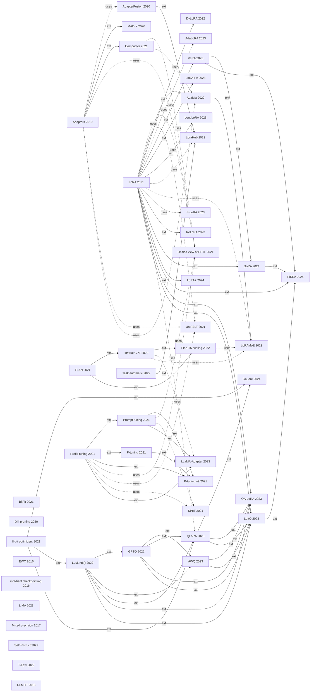

# Knowledge state summary

Topic: **Parameter-efficient fine-tuning (PEFT) of language models**  
Papers: **65** | Edges: **853** | Built: 2026-10-02T06:14:52+00:00  
Abstract source: `hand_written_paraphrase` | Reference source: `curated_from_memory_unverified`

> This file is generated from `kg.json`. `kg.json` is the source of truth.

## Edge counts by relation

| relation | count | meaning |
|---|---|---|
| BACKGROUND | 191 | Citation with no structural link in the schema. Weakest edge. |
| ADDRESSES | 113 | Paper -> Problem. The problem is named as motivation or as a measured outcome. |
| SURVEYS | 79 | A is a survey and B is one of the works it covers. Never a prerequisite. |
| PROPOSES | 66 | Paper -> Mechanism. The mechanism is part of the paper's own contribution (named in the title or in the first  |
| AUTHORED_BY | 65 | Paper -> Author (lead author). |
| EXTENDS | 46 | A refines a mechanism that B also proposes (shared PROPOSES). Strong prerequisite. |
| COMPARES_WITH_PAPER | 34 | A positions itself against the mechanism B proposes (baseline / alternative). Not a prerequisite; a 'must comp |
| USES_MODEL | 34 | Paper -> Model. Model family is adapted or evaluated in the paper. |
| USES_BACKBONE | 31 | A adapts / evaluates on a model family B introduces. Prerequisite for beginners only. |
| SUBTYPE_OF | 31 | Mechanism -> MechanismFamily. |
| BUILDS_ON | 30 | A uses a mechanism that B proposes as a component/substrate. Strong prerequisite. |
| ESTABLISHES | 30 | Paper -> Concept. The paper introduces or demonstrates the concept. |
| EVALUATED_ON | 22 | Paper -> Benchmark. Paper reports results on the benchmark. |
| USES | 22 | Paper -> Mechanism. Mechanism is used as a component / substrate but is not the contribution. |
| USES_BENCHMARK | 16 | A evaluates on a benchmark B introduces. Reference only. |
| UNDERPINS | 13 | Concept -> Mechanism. Hand-authored background knowledge (see CONCEPT_UNDERPINS). |
| MOTIVATED_BY | 8 | A rests on a concept B establishes, or on B's empirical analysis of a mechanism A uses. Prerequisite. |
| COVERS | 6 | Survey -> Mechanism. A survey describes the mechanism; it neither proposes nor uses it. |
| INTRODUCES_MODEL | 5 | Paper -> Model. Foundation-model paper that introduces the model family. |
| COMPARES_WITH | 5 | Paper -> Mechanism. Mechanism appears only in a contrastive sentence (unlike / compared with / outperforms / w |
| INTRODUCES_BENCHMARK | 3 | Paper -> Benchmark. Benchmark paper. |
| RELIES_ON | 3 | Paper -> Concept. The paper assumes or motivates itself with the concept. |

## Mechanism taxonomy and who proposed what

### ADDITIVE
_Inject new trainable parameters; the backbone stays frozen._

| mechanism | first in corpus | proposed by (chronological) | used by | proposals <=2020 / 21-22 / >=23 |
|---|---|---|---|---|
| `adapter_modules` Adapter modules | Adapters | Adapters, MAD-X, Compacter | AdapterFusion, Unified view of PETL, UniPELT, AdaMix | [2, 1, 0] |
| `soft_prompt` Soft / prefix prompts | Prefix-tuning | Prefix-tuning, Prompt tuning, P-tuning, P-tuning v2, LLaMA-Adapter | Unified view of PETL, UniPELT, SPoT | [0, 4, 1] |
| `activation_rescaling` Learned activation rescaling | T-Few | T-Few | - | [0, 1, 0] |
| `zero_init_gating` Zero-initialised gated injection | LLaMA-Adapter | LLaMA-Adapter | - | [0, 0, 1] |

### SELECTIVE
_Train only a chosen subset of the existing parameters._

| mechanism | first in corpus | proposed by (chronological) | used by | proposals <=2020 / 21-22 / >=23 |
|---|---|---|---|---|
| `bias_only` Bias-only tuning | BitFit | BitFit | - | [0, 1, 0] |
| `sparse_diff` Sparse difference vector | Diff pruning | Diff pruning | - | [1, 0, 0] |
| `gradual_unfreezing` Gradual unfreezing / discriminative LR | ULMFiT | ULMFiT | - | [1, 0, 0] |

### REPARAMETERIZATION
_Express the weight update in a cheaper form (low-rank, shared, decomposed ...)._

| mechanism | first in corpus | proposed by (chronological) | used by | proposals <=2020 / 21-22 / >=23 |
|---|---|---|---|---|
| `low_rank_update` Low-rank weight update (LoRA) | LoRA | LoRA, DyLoRA, LoftQ, LongLoRA, LoRA-FA, QA-LoRA, ReLoRA, VeRA, DoRA, LoRA+, PiSSA | Unified view of PETL, UniPELT, AdaMix, AdaLoRA, LoraHub, LoRAMoE... | [0, 2, 9] |
| `adaptive_rank` Adaptive rank / budget allocation | DyLoRA | DyLoRA, AdaLoRA | - | [0, 1, 1] |
| `weight_decomposition` Magnitude / direction decomposition | DoRA | DoRA | - | [0, 0, 1] |
| `lora_init` Informed adapter initialisation | LoftQ | LoftQ, PiSSA | - | [0, 0, 2] |
| `parameter_sharing` Parameter sharing / structured factors | Compacter | Compacter, VeRA | - | [0, 1, 1] |
| `lr_asymmetry` Asymmetric learning rates | LoRA+ | LoRA+ | - | [0, 0, 1] |
| `frozen_projection` Frozen projection matrix | LoRA-FA | LoRA-FA | - | [0, 0, 1] |
| `periodic_merge_restart` Periodic merge-and-restart | ReLoRA | ReLoRA | - | [0, 0, 1] |

### COMPRESSION
_Shrink the numeric representation of the model._

| mechanism | first in corpus | proposed by (chronological) | used by | proposals <=2020 / 21-22 / >=23 |
|---|---|---|---|---|
| `quantization` Quantization | 8-bit optimizers | 8-bit optimizers, GPTQ, LLM.int8(), AWQ, LoftQ, QA-LoRA, QLoRA | GaLore, k-bit scaling laws | [0, 3, 4] |

### COMPOSITION
_Combine, route or transfer between separately trained modules._

| mechanism | first in corpus | proposed by (chronological) | used by | proposals <=2020 / 21-22 / >=23 |
|---|---|---|---|---|
| `module_composition` Module composition / merging | AdapterFusion | AdapterFusion, AdaMix, Task arithmetic, LoraHub | - | [1, 2, 1] |
| `expert_routing` Mixture-of-experts routing | AdaMix | AdaMix, LoRAMoE | - | [0, 1, 1] |
| `prompt_transfer` Prompt transfer | SPoT | SPoT | - | [0, 1, 0] |

### TRAINING_RECIPE_AND_SYSTEMS
_Change how training / serving is executed (memory, optimizer, schedule, kernels) rather than what is learned._

| mechanism | first in corpus | proposed by (chronological) | used by | proposals <=2020 / 21-22 / >=23 |
|---|---|---|---|---|
| `low_rank_gradient` Low-rank gradient projection | GaLore | GaLore | - | [0, 0, 1] |
| `optimizer_state_compression` Optimizer-state compression | 8-bit optimizers | 8-bit optimizers, QLoRA, GaLore | - | [0, 1, 2] |
| `activation_recomputation` Gradient checkpointing | Gradient checkpointing | Gradient checkpointing | - | [1, 0, 0] |
| `mixed_precision` Mixed-precision training | Mixed precision | Mixed precision, LLM.int8() | - | [1, 1, 0] |
| `sparse_attention` Sparse / shifted attention | LongLoRA | LongLoRA | - | [0, 0, 1] |
| `serving_system` Multi-adapter serving system | S-LoRA | S-LoRA | - | [0, 0, 1] |

### SUPERVISION
_Change the data or objective used to adapt a model._

| mechanism | first in corpus | proposed by (chronological) | used by | proposals <=2020 / 21-22 / >=23 |
|---|---|---|---|---|
| `instruction_tuning` Instruction tuning | FLAN | FLAN, Flan-T5 scaling, InstructGPT | LLaMA-Adapter, VeRA, LoRAMoE, LoRA Learns Less, Forgets Less | [0, 3, 0] |
| `synthetic_instructions` Self-generated instruction data | Self-Instruct | Self-Instruct | - | [0, 1, 0] |
| `curated_data` Small curated data | LIMA | LIMA | - | [0, 0, 1] |
| `preference_alignment` Learning from human feedback | InstructGPT | InstructGPT | - | [0, 1, 0] |
| `weight_regularization` Importance-weighted regularisation | EWC | EWC | - | [1, 0, 0] |

### HYBRID
_Unify or jointly use several families._

| mechanism | first in corpus | proposed by (chronological) | used by | proposals <=2020 / 21-22 / >=23 |
|---|---|---|---|---|
| `unified_framework` Unified framework / hybrid | Unified view of PETL | Unified view of PETL, UniPELT | - | [0, 2, 0] |

## Papers by tier (influence = number of papers that transitively require it)

### FOUNDATION (10)

| paper | year | proposes | addresses | influence |
|---|---|---|---|---|
| Transformer (`transformer`) | 2017 | - | - | 0 |
| BERT (`bert`) | 2018 | - | - | 28 |
| GLUE (`glue`) | 2018 | - | multitask_transfer | 0 |
| GPT-2 (`gpt2`) | 2019 | - | multitask_transfer, unseen_task_generalization | 29 |
| SuperGLUE (`superglue`) | 2019 | - | - | 0 |
| T5 (`t5`) | 2019 | - | - | 0 |
| GPT-3 (`gpt3`) | 2020 | - | low_resource | 36 |
| MMLU (`mmlu`) | 2020 | - | multitask_transfer, low_resource, unseen_task_generalization | 0 |
| LLaMA (`llama`) | 2023 | - | - | 13 |
| Llama 2 (`llama2`) | 2023 | - | - | 7 |

### ANALYSIS (5)

| paper | year | proposes | addresses | influence |
|---|---|---|---|---|
| Intrinsic dimension (`intrinsic_dim`) | 2020 | - | trainable_param_count, design_understanding_gap | 21 |
| Scaling laws (`scaling_laws`) | 2020 | - | - | 7 |
| Chinchilla (`chinchilla`) | 2022 | - | - | 6 |
| k-bit scaling laws (`kbit_scaling`) | 2022 | - | - | 5 |
| LoRA Learns Less, Forgets Less (`lora_less_forgets`) | 2024 | - | full_finetune_cost, catastrophic_forgetting, peft_quality_gap | 0 |

### CORE_METHOD (30)

| paper | year | proposes | addresses | influence |
|---|---|---|---|---|
| EWC (`ewc`) | 2016 | weight_regularization | catastrophic_forgetting, multitask_transfer | 0 |
| Gradient checkpointing (`grad_checkpoint`) | 2016 | activation_recomputation | training_memory | 0 |
| Mixed precision (`mixed_precision`) | 2017 | mixed_precision | training_memory | 0 |
| ULMFiT (`ulmfit`) | 2018 | gradual_unfreezing | catastrophic_forgetting, low_resource | 0 |
| Adapters (`adapters`) | 2019 | adapter_modules | full_finetune_cost, trainable_param_count, multitask_transfer | 8 |
| AdapterFusion (`adapterfusion`) | 2020 | module_composition | full_finetune_cost, catastrophic_forgetting, multitask_transfer | 1 |
| Diff pruning (`diff_pruning`) | 2020 | sparse_diff | full_finetune_cost, trainable_param_count | 0 |
| BitFit (`bitfit`) | 2021 | bias_only | full_finetune_cost, trainable_param_count | 0 |
| Compacter (`compacter`) | 2021 | adapter_modules, parameter_sharing | trainable_param_count | 3 |
| 8-bit optimizers (`eightbit_optim`) | 2021 | quantization, optimizer_state_compression | training_memory | 9 |
| FLAN (`flan`) | 2021 | instruction_tuning | unseen_task_generalization | 4 |
| LoRA (`lora`) | 2021 | low_rank_update | full_finetune_cost, training_memory, trainable_param_count, inference_latency | 20 |
| Prefix-tuning (`prefix_tuning`) | 2021 | soft_prompt | full_finetune_cost, trainable_param_count, low_resource | 7 |
| SPoT (`spot`) | 2021 | prompt_transfer | full_finetune_cost, scale_gap | 0 |
| Unified view of PETL (`unified_view`) | 2021 | unified_framework | full_finetune_cost, trainable_param_count, design_understanding_gap | 0 |
| AdaMix (`adamix`) | 2022 | module_composition, expert_routing | full_finetune_cost, trainable_param_count, inference_latency | 1 |
| DyLoRA (`dylora`) | 2022 | low_rank_update, adaptive_rank | trainable_param_count, budget_allocation | 0 |
| InstructGPT (`instructgpt`) | 2022 | instruction_tuning, preference_alignment | alignment_with_intent | 3 |
| Self-Instruct (`self_instruct`) | 2022 | synthetic_instructions | instruction_data_cost, unseen_task_generalization | 0 |
| T-Few (`t_few`) | 2022 | activation_rescaling | trainable_param_count, inference_latency, low_resource | 1 |
| LIMA (`lima`) | 2023 | curated_data | instruction_data_cost | 0 |
| LLaMA-Adapter (`llama_adapter`) | 2023 | soft_prompt, zero_init_gating | trainable_param_count | 0 |
| LoftQ (`loftq`) | 2023 | low_rank_update, lora_init, quantization | quantization_error | 1 |
| LongLoRA (`longlora`) | 2023 | low_rank_update, sparse_attention | full_finetune_cost, long_context | 0 |
| LoRA-FA (`lora_fa`) | 2023 | low_rank_update, frozen_projection | training_memory | 0 |
| ReLoRA (`relora`) | 2023 | low_rank_update, periodic_merge_restart | training_memory, pretraining_cost | 1 |
| S-LoRA (`s_lora`) | 2023 | serving_system | training_memory, adapter_serving_scale | 0 |
| DoRA (`dora`) | 2024 | low_rank_update, weight_decomposition | full_finetune_cost, inference_latency, peft_quality_gap | 2 |
| GaLore (`galore`) | 2024 | low_rank_gradient, optimizer_state_compression | training_memory, pretraining_cost | 0 |
| LoRA+ (`lora_plus`) | 2024 | low_rank_update, lr_asymmetry | peft_quality_gap | 1 |

### EXTENSION (17)

| paper | year | proposes | addresses | influence |
|---|---|---|---|---|
| MAD-X (`madx`) | 2020 | adapter_modules | trainable_param_count, multitask_transfer | 0 |
| Prompt tuning (`prompt_tuning`) | 2021 | soft_prompt | full_finetune_cost, trainable_param_count, scale_gap, low_resource | 4 |
| P-tuning (`ptuning`) | 2021 | soft_prompt | low_resource, training_instability, peft_quality_gap | 1 |
| P-tuning v2 (`ptuning_v2`) | 2021 | soft_prompt | full_finetune_cost, scale_gap, peft_quality_gap | 0 |
| UniPELT (`unipelt`) | 2021 | unified_framework | full_finetune_cost, trainable_param_count, low_resource | 0 |
| Flan-T5 scaling (`flan_scaling`) | 2022 | instruction_tuning | - | 1 |
| GPTQ (`gptq`) | 2022 | quantization | training_memory, quantization_error | 7 |
| LLM.int8() (`llm_int8`) | 2022 | quantization, mixed_precision | training_memory, quantization_error | 8 |
| Task arithmetic (`task_arithmetic`) | 2022 | module_composition | multitask_transfer | 1 |
| AdaLoRA (`adalora`) | 2023 | adaptive_rank | trainable_param_count, budget_allocation | 0 |
| AWQ (`awq`) | 2023 | quantization | inference_latency, quantization_error | 3 |
| LoraHub (`lorahub`) | 2023 | module_composition | inference_latency, multitask_transfer, low_resource, unseen_task_generalization | 0 |
| LoRAMoE (`loramoe`) | 2023 | expert_routing | catastrophic_forgetting | 0 |
| QA-LoRA (`qa_lora`) | 2023 | low_rank_update, quantization | inference_latency, quantization_error | 0 |
| QLoRA (`qlora`) | 2023 | quantization, optimizer_state_compression | training_memory | 4 |
| VeRA (`vera`) | 2023 | low_rank_update, parameter_sharing | trainable_param_count | 3 |
| PiSSA (`pissa`) | 2024 | low_rank_update, lora_init | quantization_error, training_instability | 0 |

### SURVEY (3)

| paper | year | proposes | addresses | influence |
|---|---|---|---|---|
| Delta tuning (`delta_tuning`) | 2022 | - | trainable_param_count | 0 |
| Scaling Down to Scale Up (`scaling_down`) | 2023 | - | training_memory, trainable_param_count | 0 |
| PEFT survey (2024) (`peft_survey`) | 2024 | - | training_memory, trainable_param_count, multitask_transfer, adapter_serving_scale | 0 |

## Lineage graph (EXTENDS = solid, BUILDS_ON = dashed; method papers only)

## Mechanism x problem coverage (method papers; count of papers proposing or using)

- **activation_recomputation**: training_memory (1)
- **activation_rescaling**: trainable_param_count (1), inference_latency (1), low_resource (1)
- **adapter_modules**: trainable_param_count (6), full_finetune_cost (5), multitask_transfer (3), catastrophic_forgetting (1), design_understanding_gap (1), low_resource (1), inference_latency (1)
- **adaptive_rank**: trainable_param_count (2), budget_allocation (2)
- **bias_only**: full_finetune_cost (1), trainable_param_count (1)
- **curated_data**: instruction_data_cost (1)
- **expert_routing**: full_finetune_cost (1), trainable_param_count (1), inference_latency (1), catastrophic_forgetting (1)
- **frozen_projection**: training_memory (1)
- **gradual_unfreezing**: catastrophic_forgetting (1), low_resource (1)
- **instruction_tuning**: trainable_param_count (2), unseen_task_generalization (1), alignment_with_intent (1), catastrophic_forgetting (1)
- **lora_init**: quantization_error (2), training_instability (1)
- **low_rank_gradient**: training_memory (1), pretraining_cost (1)
- **low_rank_update**: trainable_param_count (7), full_finetune_cost (6), training_memory (5), inference_latency (5), quantization_error (3), low_resource (2), budget_allocation (2), peft_quality_gap (2), design_understanding_gap (1), long_context (1), multitask_transfer (1), unseen_task_generalization (1), catastrophic_forgetting (1), adapter_serving_scale (1), pretraining_cost (1), training_instability (1)
- **lr_asymmetry**: peft_quality_gap (1)
- **mixed_precision**: training_memory (2), quantization_error (1)
- **module_composition**: multitask_transfer (3), full_finetune_cost (2), inference_latency (2), catastrophic_forgetting (1), trainable_param_count (1), low_resource (1), unseen_task_generalization (1)
- **optimizer_state_compression**: training_memory (3), pretraining_cost (1)
- **parameter_sharing**: trainable_param_count (2)
- **periodic_merge_restart**: training_memory (1), pretraining_cost (1)
- **preference_alignment**: alignment_with_intent (1)
- **prompt_transfer**: full_finetune_cost (1), scale_gap (1)
- **quantization**: training_memory (5), quantization_error (5), inference_latency (2), pretraining_cost (1)
- **serving_system**: training_memory (1), adapter_serving_scale (1)
- **soft_prompt**: full_finetune_cost (6), trainable_param_count (5), low_resource (4), scale_gap (3), peft_quality_gap (3), training_instability (1), design_understanding_gap (1)
- **sparse_attention**: full_finetune_cost (1), long_context (1)
- **sparse_diff**: full_finetune_cost (1), trainable_param_count (1)
- **synthetic_instructions**: instruction_data_cost (1), unseen_task_generalization (1)
- **unified_framework**: full_finetune_cost (2), trainable_param_count (2), design_understanding_gap (1), low_resource (1)
- **weight_decomposition**: full_finetune_cost (1), inference_latency (1), peft_quality_gap (1)
- **weight_regularization**: catastrophic_forgetting (1), multitask_transfer (1)
- **zero_init_gating**: trainable_param_count (1)

## Problems and how many method papers attack them

- **trainable_param_count** (Per-task parameters / storage): 20 papers; top mechanisms: low_rank_update, adapter_modules, soft_prompt, instruction_tuning
- **full_finetune_cost** (Cost of full fine-tuning): 15 papers; top mechanisms: soft_prompt, low_rank_update, adapter_modules, module_composition
- **training_memory** (Training memory footprint): 13 papers; top mechanisms: low_rank_update, quantization, optimizer_state_compression, mixed_precision
- **multitask_transfer** (Multi-task / cross-task transfer): 10 papers; top mechanisms: adapter_modules, module_composition, low_rank_update, weight_regularization
- **low_resource** (Low-resource / few-shot adaptation): 9 papers; top mechanisms: soft_prompt, low_rank_update, gradual_unfreezing, adapter_modules
- **inference_latency** (Inference latency / cost): 7 papers; top mechanisms: low_rank_update, module_composition, quantization, adapter_modules
- **quantization_error** (Quantization error / outliers): 6 papers; top mechanisms: quantization, low_rank_update, lora_init, mixed_precision
- **peft_quality_gap** (Quality gap vs full fine-tuning): 6 papers; top mechanisms: soft_prompt, low_rank_update, weight_decomposition, lr_asymmetry
- **catastrophic_forgetting** (Catastrophic forgetting): 5 papers; top mechanisms: gradual_unfreezing, instruction_tuning, adapter_modules, module_composition
- **unseen_task_generalization** (Generalising to unseen tasks): 5 papers; top mechanisms: instruction_tuning, synthetic_instructions, module_composition, low_rank_update
- **scale_gap** (Gap between small and large models): 3 papers; top mechanisms: soft_prompt, prompt_transfer
- **design_understanding_gap** (Poor understanding of design choices): 2 papers; top mechanisms: adapter_modules, soft_prompt, low_rank_update, unified_framework
- **budget_allocation** (Where to spend the parameter budget (rank selection)): 2 papers; top mechanisms: low_rank_update, adaptive_rank
- **adapter_serving_scale** (Serving many adapters): 2 papers; top mechanisms: low_rank_update, serving_system
- **pretraining_cost** (Cost of pre-training from scratch): 2 papers; top mechanisms: low_rank_update, periodic_merge_restart, quantization, low_rank_gradient
- **instruction_data_cost** (Cost / quality of instruction data): 2 papers; top mechanisms: synthetic_instructions, curated_data
- **training_instability** (Unstable or slow training / convergence): 2 papers; top mechanisms: soft_prompt, low_rank_update, lora_init
- **long_context** (Long-context adaptation): 1 papers; top mechanisms: low_rank_update, sparse_attention
- **alignment_with_intent** (Models not following user intent): 1 papers; top mechanisms: instruction_tuning, preference_alignment
